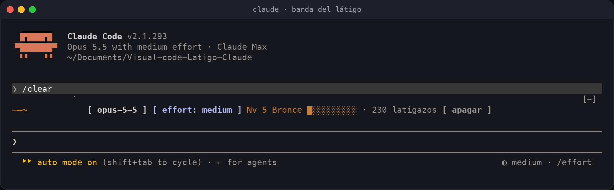
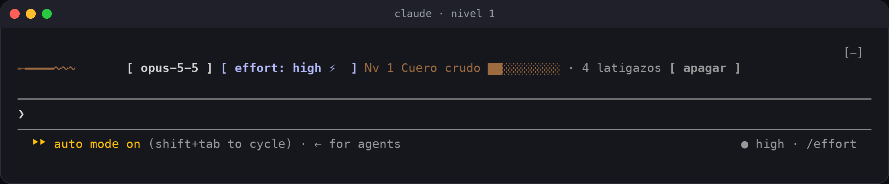
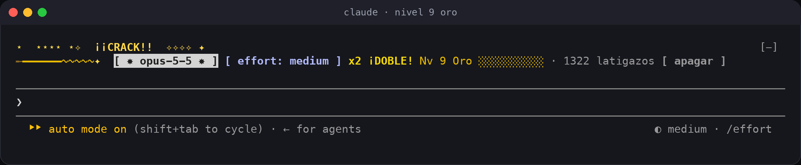
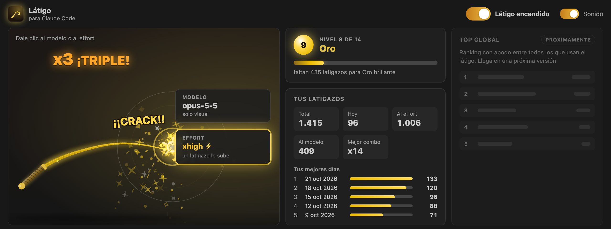
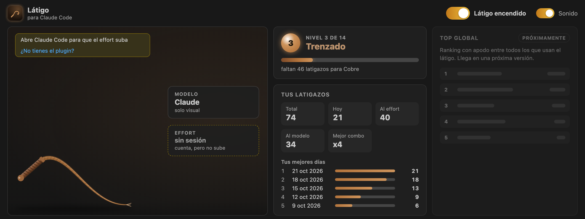
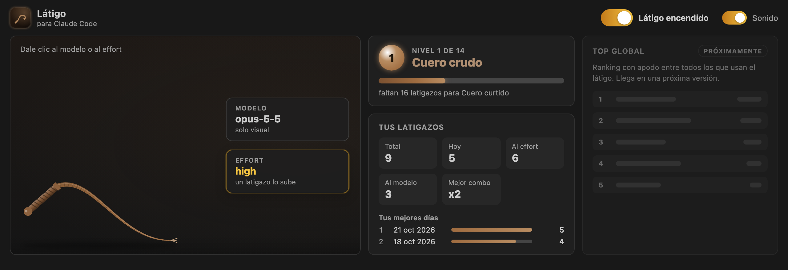
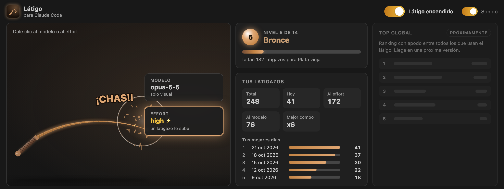
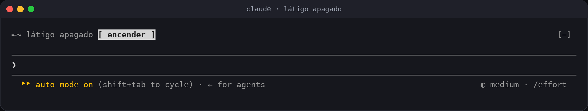

# Látigo para Claude Code

*¡Suashh… CHAS!* Un látigo para darle ánimo a Claude Code. Si le pegas al **modelo**, es puro desahogo. Si le pegas al **effort**, sube un nivel. Mientras más lo usas, más dorado, brillante y épico se pone, muy poco a poco.


Viene en dos piezas que funcionan solas o juntas:

| | Plugin de Claude Code | Extensión de VS Code |
|---|---|---|
| Qué ves | Una banda encima del prompt | Un panel con el látigo animado en canvas y la barra de estado |
| Sube el effort | Sí, en cada pedido al modelo | Sí, a través de la sesión de Claude Code abierta |
| Prender y apagar | Botón `apagar`/`encender`, tecla `o`, `/latigo on\|off` | Interruptor, botón y tecla global (`Ctrl+Cmd+L` en macOS, `Shift+Alt+L` en Windows y Linux) |
| Instalación | `/plugin install latigo --marketplace ronalc90/Visual-code-Latigo-Claude` | El `.vsix` de la [versión v0.2.0](https://github.com/ronalc90/Visual-code-Latigo-Claude/releases/tag/v0.2.0) (pronto en el Marketplace) |

---

## Contenido

- [Cómo se usa](#cómo-se-usa)
- [En VS Code](#en-vs-code)
- [Niveles: el látigo se va dorando](#niveles-el-látigo-se-va-dorando)
- [Combos](#combos)
- [Prender y apagar](#prender-y-apagar)
- [Instalación](#instalación)
- [Comandos y teclas](#comandos-y-teclas)
- [Cómo funciona el effort](#cómo-funciona-el-effort)
- [Privacidad](#privacidad)
- [Preguntas frecuentes](#preguntas-frecuentes)
- [Desarrollo](#desarrollo)

## Cómo se usa

En Claude Code aparece una banda encima del prompt:



| Le das a… | Pasa esto |
|---|---|
| `[ opus-5-5 ]` (el modelo) | Latigazo con animación y sonido. Solo visual. |
| `[ effort: … ]` | Lo mismo, y además el effort sube un nivel: `low → medium → high → xhigh → max`. El ⚡ indica que lo está forzando el látigo. |
| `[ apagar ]` | Apaga el látigo. La banda queda en reposo con un botón `encender`. |

Se puede hacer clic o usar el teclado. Con `ctrl+x tab` (o un clic) la banda queda enfocada, y desde ahí `e` le pega al effort, `m` al modelo y `o` prende o apaga.

| Nivel 1 · el primer ¡CHAS! | Nivel 9 · Oro, combo x2 |
|---|---|
|  |  |

## En VS Code

La extensión trae el panel **Látigo**: el látigo dibujado en canvas, con chispas que caen y se apagan, destello en la punta y sacudida en los combos grandes. Al lado van el nivel con su barra, tus números, tus mejores días y el **Top global**, que por ahora aparece en gris porque llega en una próxima versión.



| Nivel 14 · subiendo a Divino | Sin sesión de Claude Code abierta |
|---|---|
|  |  |

| Nivel 1 · Cuero crudo en reposo | Nivel 5 · Bronce en pleno latigazo |
|---|---|
|  |  |

Con el interruptor apagado, el panel queda en calma:


En la barra de estado aparece `Látigo · Nv N`, y un clic abre el panel. Todos los comandos, atajos y ajustes están en la [página de la extensión](vscode/README.md).

## Niveles: el látigo se va dorando

Son 14 niveles. Cada latigazo corre el color **un poquito** hacia el del nivel siguiente, así que no se nota de un golpe a otro, pero sí de una semana a otra. Las chispas aparecen en el nivel 3, se vuelven estrellas en los niveles de plata y oro, y al final son una lluvia. Al subir de nivel suena un arpegio y aparece un aviso.


| Nv | Nombre | Desde | | Nv | Nombre | Desde |
|---:|---|---:|---|---:|---|---:|
| 1 | Cuero crudo | 0 | | 8 | Oro pálido | 900 |
| 2 | Cuero curtido | 25 | | 9 | Oro | 1.300 |
| 3 | Trenzado | 60 | | 10 | Oro brillante | 1.850 |
| 4 | Cobre | 120 | | 11 | Oro real | 2.600 |
| 5 | Bronce | 220 | | 12 | Dorado épico | 3.600 |
| 6 | Plata vieja | 380 | | 13 | Legendario | 5.000 |
| 7 | Plata | 600 | | 14 | Divino | 7.000 |

## Combos

Dos latigazos con menos de 1,5 s entre uno y otro suman combo:

`x2 ¡DOBLE!` · `x3 ¡TRIPLE!` · `x5 ¡FURIA!` · `x7 ¡IMPARABLE!` · `x10 ¡LEYENDA!` · `x20 ¡¡DIOS DEL LÁTIGO!!`

Tu mejor combo queda guardado en la tabla.

## Prender y apagar

Hay un solo interruptor para las dos piezas: apagarlo en VS Code también lo apaga en Claude Code, y al revés.

| Dónde | Cómo |
|---|---|
| VS Code, desde cualquier parte | `Ctrl+Cmd+L` en macOS, `Shift+Alt+L` en Windows y Linux |
| Panel de VS Code | El interruptor grande o el botón de la barra del panel |
| Barra de estado de VS Code | Clic en `Látigo` para abrir el panel |
| Banda de Claude Code | Botón `apagar` / `encender`, o `o` con la banda enfocada |
| Prompt de Claude Code | `/latigo off` y `/latigo on` |

Con el látigo apagado no hay animación ni sonido, y el effort vuelve a ser el de la sesión: al prenderlo otra vez arranca sin effort forzado.



## Instalación

### Plugin de Claude Code

En una terminal, dentro de `claude`:

```
/plugin install latigo --marketplace ronalc90/Visual-code-Latigo-Claude
```

Responde `y` para agregar el marketplace y elige el alcance (Enter toma el de usuario). Queda activo de una vez. Desde la línea de comandos, fuera de una sesión:

```
claude plugin install latigo --marketplace ronalc90/Visual-code-Latigo-Claude
```

### Extensión de VS Code

Por ahora se instala con el `.vsix` de la [versión v0.2.0](https://github.com/ronalc90/Visual-code-Latigo-Claude/releases/tag/v0.2.0). Pronto estará en el Marketplace de VS Code.

Desde la consola (macOS y Linux):

```
curl -LO https://github.com/ronalc90/Visual-code-Latigo-Claude/releases/download/v0.2.0/latigo-claude-0.2.0.vsix
code --install-extension latigo-claude-0.2.0.vsix
```

En Windows (PowerShell), lo mismo con `curl.exe` en lugar de `curl`.

Sin consola, descarga el `.vsix` de la versión y en VS Code ve a **Extensiones** → menú **…** → **Instalar desde VSIX…**.

Si la consola no reconoce `code` en macOS, en VS Code abre la paleta (`Cmd+Shift+P`) y corre **Shell Command: Install 'code' command in PATH**.

La extensión también trae el comando **Látigo: Instalar el plugin en Claude Code**, que abre una terminal con el comando listo.

## Comandos y teclas

### En Claude Code

| Comando | Hace |
|---|---|
| `/latigo` | Tu tabla: nivel, barra de progreso, latigazos (total, hoy, al effort, al modelo), mejor combo, días con más latigazos y el Top global (próximamente) |
| `/latigo on` · `/latigo off` | Prende o apaga el látigo (también en VS Code) |
| `/latigo calma` | Quita el effort que forzó el látigo |
| `/latigo sonido` | Prende o apaga el sonido |
| `/latigo ayuda` | Esta lista |

| Tecla (con la banda enfocada) | Hace |
|---|---|
| `e` | Latigazo al effort |
| `m` | Latigazo al modelo |
| `o` | Prende o apaga |

### En VS Code

Ver la [página de la extensión](vscode/README.md#comandos).

## Cómo funciona el effort

Antes de cada pedido al modelo, Claude Code les pasa a los plugins el effort con el que va a salir, y el látigo puede subirlo. Si forzaste `xhigh` y el pedido iba en `medium`, sale en `xhigh`.

- **Nunca baja.** Si la sesión ya va en `max`, se queda en `max`.
- **Solo toca la conversación principal**, no los subagentes.
- **Dura lo que dura la sesión**, o hasta `/latigo calma` o apagar el látigo.
- **El indicador propio de Claude Code** (`◐ medium · /effort`) sigue mostrando el effort de la sesión. Lo que el látigo fuerza se ve en la banda con ⚡.

Los detalles están en [docs/arquitectura.md](docs/arquitectura.md).

## Privacidad

- **No usa la red** en ninguna de las dos piezas.
- **Todo queda en tu máquina:** los conteos y el interruptor viven en `~/.claude-latigo/`, unos archivos JSON pequeños que puedes borrar cuando quieras.
- **No lee tu código ni tus conversaciones.** Del modelo solo ve el nombre y el effort de cada pedido.

## Preguntas frecuentes

**¿Interrumpe lo que Claude está haciendo?**
No. A diferencia de los látigos que mandan `Ctrl-C`, este nunca corta el turno en curso.

**¿Por qué no suena?**
El sonido usa el reproductor de macOS. En Linux y Windows el látigo se ve pero no suena dentro de la terminal; en el panel de VS Code sí suena en todos lados. Revisa también `/latigo sonido`.

**¿Puedo ver el látigo sin tanta animación?**
Sí. Si activas *Reduce motion* en la configuración de Claude Code, el látigo va directo al golpe y las chispas no titilan. En VS Code está el ajuste `latigo.reducedMotion`.

**¿Qué pasa si borro `~/.claude-latigo/`?**
Nada grave. El plugin también guarda los conteos en su propio almacén y los vuelve a escribir en el próximo latigazo, así que todavía no hay forma de reiniciarlos. El interruptor vuelve a quedar encendido.

**¿Y si tengo varias sesiones de Claude Code abiertas?**
Todas comparten el látigo. Un latigazo al effort desde VS Code las sube a todas, y el panel muestra el modelo y el effort de la que habló último. Un latigazo en la banda de una sesión sube solo esa.

**¿Funciona en Windows?**
Sí. El plugin y la extensión buscan la misma carpeta: `LATIGO_HOME`, luego `HOME` y si no la carpeta del usuario (`USERPROFILE`). En la terminal no suena, pero en el panel de VS Code sí.

## Desarrollo

```
claude --plugin-dir ./           # corre el plugin desde esta carpeta
claude plugin validate ./        # revisa manifiesto, marketplace y hooks
claude plugin test ./            # 91 pruebas del plugin
npx tsc -p .                     # tipos (Claude Code los deja en .claude-plugin/types/ al cargar el plugin)
cd vscode && npm ci --include=dev && npm test   # 115 unitarias + 15 de integración de la extensión
python scripts/e2e_puente.py --claude "$(which claude)"   # 19 de punta a punta con Claude Code real
```

| Carpeta | Qué hay |
|---|---|
| `hooks/` | Plugin de Claude Code y las reglas compartidas (`model.ts`, `levels.ts`, `bridge.ts`) |
| `types/` | Tipos y contrato de estado del plugin |
| `assets/` | Sonidos generados desde cero: `latigo.wav` y `nivel.wav` |
| `tests/` | Pruebas del plugin |
| `vscode/` | Extensión de VS Code |
| `scripts/` | Capturas reales del terminal (`capturas_terminal.py`) y la imagen de niveles (`evolucion.py`) |
| `docs/` | [Arquitectura](docs/arquitectura.md), [pruebas](docs/pruebas.md), [cómo publicar](docs/publicar.md) e imágenes |

## Lo que viene

- **Top global:** un ranking opcional, con apodo, de quién da más latigazos. Ya aparece en gris en el panel y en la tabla.

## Inspiración

[OpenWhip](https://github.com/GitFrog1111/OpenWhip) fue el primer látigo. Este nació para hacer lo mismo sin interrumpir el trabajo.

## Licencia

[MIT](LICENSE) © Ronald Cipagauta
