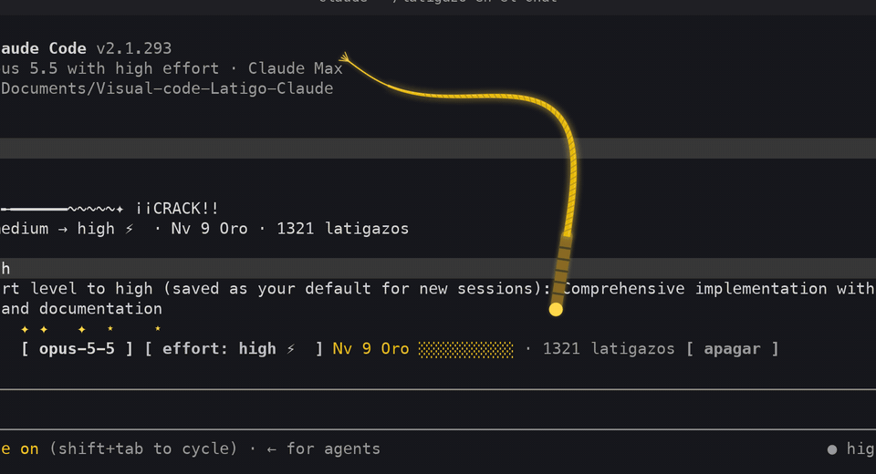
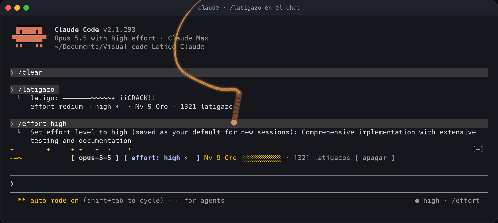
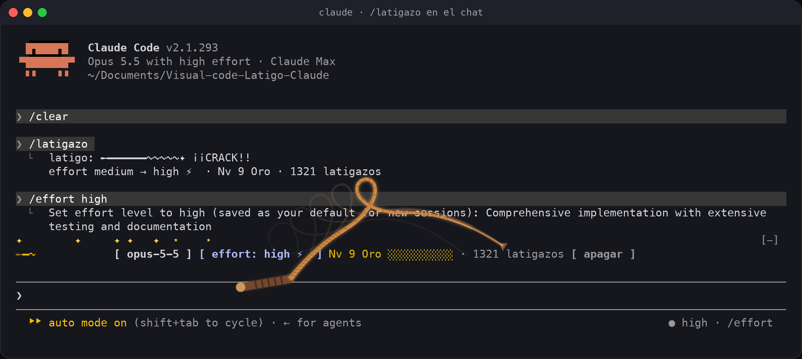
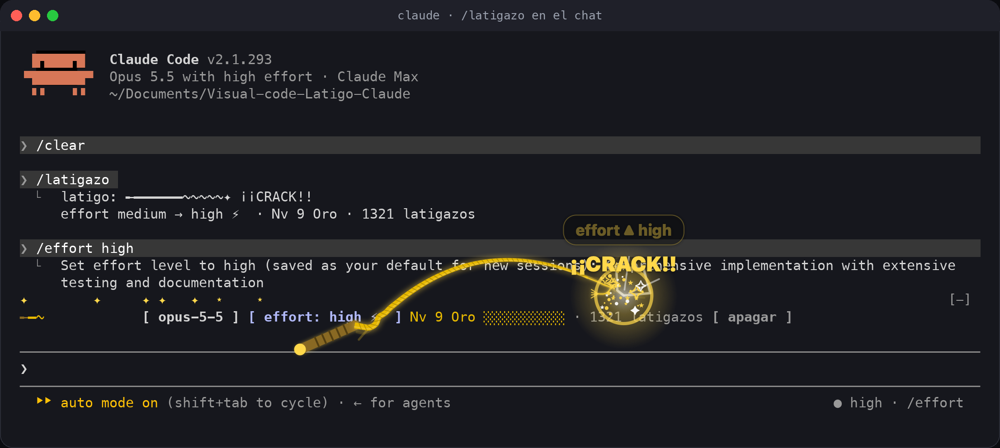
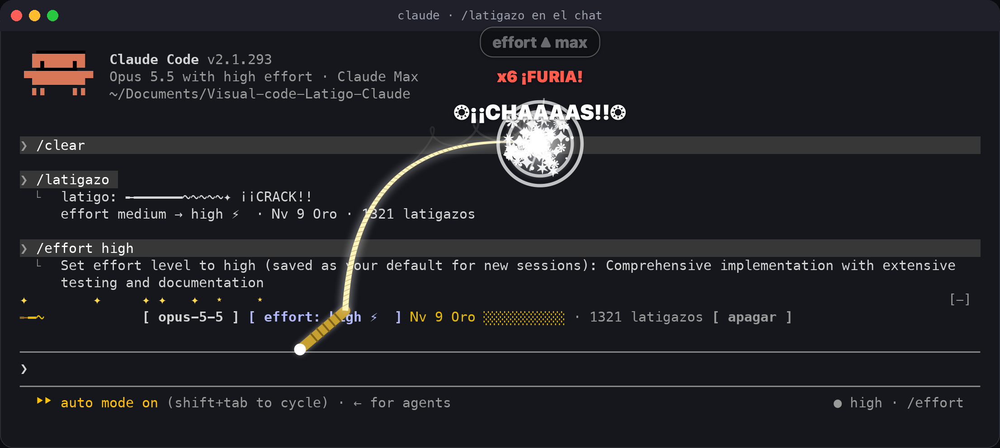
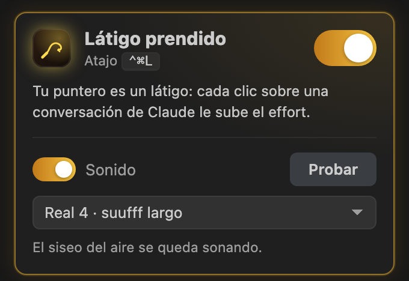
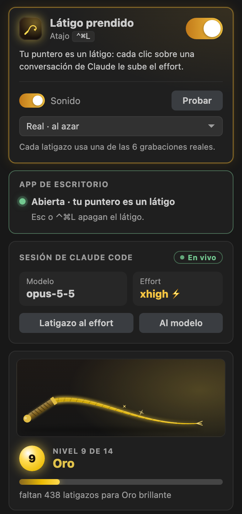

# Látigo para Claude Code

*Suufff… ¡CHAS!* Un látigo para darle ánimo a Claude Code. Lo prendes con **`⌃⌘L`** y tu puntero sostiene un látigo por el mango: la cuerda cuelga y se mece con cada movimiento del mouse. Con cada clic das un latigazo: el bucle corre del mango a la punta y la punta revienta lejos de la mano, hacia donde lo lanzaste. Si el clic o el golpe caen sobre una conversación de Claude, el **effort sube un nivel**. Mientras más lo usas, más dorado, brillante y épico se pone, muy poco a poco.



Son tres piezas que se hablan entre sí (todo queda en tu máquina, sin red):

| Pieza | Qué hace | Dónde |
|---|---|---|
| **App de escritorio** (Mac) | Tu puntero sostiene un látigo y cada clic da un latigazo encima de la pantalla: sobre VS Code, la terminal o lo que tengas | Ícono en la barra de menú · `⌃⌘L` |
| **Plugin de Claude Code** | Sube el effort de verdad (con `/effort`), cuenta los latigazos, y en la consola dibuja una banda encima del prompt | Consola y chat de Claude en VS Code |
| **Extensión de VS Code** | El interruptor, el sonido, tu sesión y tus estadísticas en la barra de la izquierda | Barra de actividad de VS Code |

**Un solo interruptor:** *Látigo prendido* es lo mismo en las tres. Lo prendes o lo apagas desde donde quieras (`⌃⌘L`, `Esc`, el menú de la app, la barra de VS Code, `/latigo on` o `off`) y cambia en todas.

---

## Contenido

- [Cómo se usa](#cómo-se-usa)
- [App de escritorio](#app-de-escritorio)
- [El sonido: como un látigo de verdad](#el-sonido-como-un-látigo-de-verdad)
- [En la consola](#en-la-consola)
- [En VS Code](#en-vs-code)
- [Niveles: el látigo se va dorando](#niveles-el-látigo-se-va-dorando)
- [Instalación](#instalación)
- [Comandos y atajos](#comandos-y-atajos)
- [Cómo funciona el effort](#cómo-funciona-el-effort)
- [Privacidad](#privacidad)
- [Preguntas frecuentes](#preguntas-frecuentes)
- [Desarrollo](#desarrollo)

## Cómo se usa

1. Abre la app **Látigo**. Queda como un látigo en la barra de menú, arriba a la derecha, y desde ahí se abre sola al iniciar sesión.
2. Presiona **`⌃⌘L`** (Control + Comando + L) en cualquier app: aparece *Látigo prendido* junto al puntero y en tu mano aparece el látigo, con el pomo del mango en el puntero.
3. Mueve el mouse: la cuerda cuelga y se mece; si lo mueves rápido, va detrás por el mismo camino. Haz clic sobre tu conversación de Claude (en VS Code, la terminal o la app de Claude): el látigo se lanza hacia donde movías el mouse (o, quieto, hacia donde apunta el mango) y **¡CHAS!**, la punta revienta allá. El effort sube un nivel (`medium → high → xhigh → max`) y lo ves en el golpe: **effort ▲ high**.
4. **`Esc`** o **`⌃⌘L`** lo apagan.

Los clics siguen funcionando mientras tanto: el latigazo solo se dibuja encima. Un clic fuera de una conversación de Claude es puro desahogo: suena, revienta y cuenta para tu nivel, pero no toca el effort. Varios seguidos (menos de 1,5 s entre uno y otro) hacen combo: `x2 ¡DOBLE!`, `x3 ¡TRIPLE!`, `x5 ¡FURIA!`, `x7 ¡IMPARABLE!`, `x10 ¡LEYENDA!`, `x20 ¡¡DIOS DEL LÁTIGO!!`.

Para volver al effort de antes: `/latigo calma` en Claude Code, o apagar el látigo.

## App de escritorio

| En la mano: el mango en el puntero y la cuerda colgando | Arrastrado, va detrás por el mismo camino |
|---|---|
|  |  |
| **El latigazo: un bucle corre del mango a la punta** | **La punta revienta lejos de la mano y sube el effort** |
|  |  |

- **Lo sostienes por el mango.** El pomo va en tu puntero; la cuerda cuelga y se mece. Si mueves el mouse rápido, va detrás por el mismo camino: en línea recta queda tendida, en curva se curva y en zigzag ondula. El mango apunta hacia donde te mueves y nunca contra el borde de la pantalla.
- **El latigazo es como el de un látigo de verdad.** La muñeca apunta el mango hacia el lanzamiento, la cuerda se tiende y un bucle sale del mango y corre hasta la punta, cada vez más rápido. Cuando llega, la punta da la vuelta y **revienta lejos de la mano**: a un mango y casi una cuerda de distancia. Quedan estelas de la cuerda, la raya de la punta y la onda de choque. Si mueves la mano durante el latigazo, el látigo va con ella.
- **Hacia dónde sale:** hacia donde movías el mouse; quieto, hacia donde apunta el mango (arriba). Si el golpe fuera a caer fuera de la pantalla, sale hacia el otro lado o más acostado, para que lo veas entero.
- **Cambia con cómo mueves el mouse:**

  | Movimiento | El latigazo |
  |---|---|
  | Quieto | Hacia donde apunta el mango, por arriba |
  | Recto | Hacia donde ibas, tendido y largo |
  | Con giro | Se adelanta hacia el giro, más curvo, con el bucle de ese lado |
  | Zigzag | La cuerda ondula y truena dos veces |

  Mientras más rápido, más corto (de 0,14 a 0,36 s), más fuerte y con más chispas.
- **El golpe:** destello, onda de choque, chispas del color de tu nivel y el grito del nivel (de `¡CHAS!` a `❂¡¡CHAAAAS!!❂`). Encima, lo que le hizo al effort: **effort ▲ high**, *effort ya en max* o *sin sesión de Claude Code*.
- **Sube el effort solo sobre Claude:** si el clic o el golpe caen sobre VS Code (y Cursor, Windsurf, VSCodium), Terminal, iTerm2, Warp, Ghostty, kitty, Alacritty, WezTerm o la app de Claude. Necesita el plugin instalado y una sesión abierta.
- **Menú de la barra:** el interruptor; *Esc también lo apaga* (desmárcalo si usas `Esc` para detener a Claude); el sonido, con vista previa; tu nivel; si el atajo funciona; abrir al iniciar sesión; y salir.
- **Pantallas:** dibuja en todas las pantallas conectadas, también sobre apps a pantalla completa. Si tienes *Reducir movimiento* activo en macOS, el latigazo es casi inmediato y sin estelas.



Las fotos y el GIF los dibuja la misma app (`--demo` y `--frames`) encima de una captura real de Claude Code.

## El sonido: como un látigo de verdad

Un látigo no hace *crash*. Se midieron 6 grabaciones reales (de [BigSoundBank](https://bigsoundbank.com), dominio público) con `scripts/sonidos_reales.py`:

| | Lo que se midió |
|---|---|
| **Antes del golpe** | El zumbido de la cuerda casi no se oye: 40 a 60 dB por debajo del golpe. Solo en los latigazos completos se oye el aire cortado |
| **El golpe** | Un chasquido instantáneo que cubre todas las frecuencias, centrado entre 4,4 y 5,6 kHz y sin graves. A veces es doble |
| **Después** | Un siseo agudo que se apaga en 120 a 500 ms: el **suufff** del aire roto |

El chasquido es la punta (o el bucle que viaja por la cuerda) pasando la barrera del sonido, cerca de Mach 2 durante ~1,2 ms ([Krehl y Engemann](https://publica.fraunhofer.de/handle/publica/193228), [Scientific American](https://www.scientificamerican.com/article/true-cause-of-whips-crack)).

**Elige tu sonido** en el menú de la app (**Sonido**), en la barra de VS Code o con `/latigo sonido <nombre>`:

| Sonido | Cómo suena | Nombre |
|---|---|---|
| **Real · al azar** (el de siempre) | Cada latigazo usa una de las 6 grabaciones | `real` |
| Real 1 · seco | Chasquido limpio y corto | `real-1` |
| Real 2 · doble | Dos chasquidos casi juntos | `real-2` |
| Real 3 · corto | Chasquido corto con un eco leve | `real-3` |
| Real 4 · suufff largo | El siseo del aire se queda sonando | `real-4` |
| Real 5 · completo | Se oye el látigo cortando el aire antes del golpe | `real-5` |
| Real 6 · completo 2 | Otro latigazo completo, más seco | `real-6` |
| Aire · sintético | Hecho imitando las grabaciones; en la app cambia con cómo mueves el mouse | `aire` |
| Suave · para la oficina | Un chasquido bajito y corto | `suave` |



En todas partes **el chasquido cae justo con el golpe**: en la app, cuando la punta revienta; en la consola, cuando la banda revienta. En la app, *Zumbido al mover el látigo* agrega un soplido corto cuando mueves el mouse rápido (viene apagado).

Créditos: [assets/sonidos/CREDITOS.md](assets/sonidos/CREDITOS.md).

## En la consola

En `claude` aparece una banda encima del prompt: clic en el effort (lo sube) o en el modelo (desahogo), y el botón `apagar`. Con `ctrl+x tab` la enfocas y usas `e`, `m` y `o`. `/latigazo` hace lo mismo escribiéndolo.


## En VS Code

El chat de Claude Code en VS Code no dibuja interfaz de plugins, así que el golpe en pantalla lo pone la app de escritorio. La extensión trae, en la **barra de la izquierda**:

- **El interruptor** del látigo, con su atajo (`⌃⌘L` en Mac, `Shift+Alt+L` en Windows y Linux).
- **El sonido:** prenderlo o apagarlo, elegir entre los 9 y **Probar**.
- **La app de escritorio:** si está abierta y si tu puntero es un látigo; si está cerrada, un botón para abrirla. Si otra app tiene el atajo, también lo avisa.
- **La sesión de Claude:** modelo y effort (con ⚡ cuando el látigo lo está subiendo), y dos latigazos pequeños, al effort y al modelo.
- **El látigo de tu nivel** en miniatura, que también restalla con los golpes que das desde la pantalla o la consola.
- **Nivel, progreso, tus números, tus mejores días** y el **Top global** (en gris: llega en una próxima versión).

| Barra lateral | Con la app abierta | App cerrada |
|---|---|---|
|  |  |  |

Al entrar a una conversación de Claude, la barra se abre sola si el látigo está prendido (ajuste `latigo.showWithClaude`). En `/latigazo` el chat de VS Code funciona igual que la consola.

## Niveles: el látigo se va dorando

Son 14 niveles. Cada latigazo corre el color **un poquito** hacia el del nivel siguiente: no se nota de un golpe a otro, pero sí de una semana a otra. Las chispas aparecen en el nivel 3 y al final son una lluvia. Subir de nivel tiene sonido y aviso propios.


| Nv | Nombre | Desde | | Nv | Nombre | Desde |
|---:|---|---:|---|---:|---|---:|
| 1 | Cuero crudo | 0 | | 8 | Oro pálido | 900 |
| 2 | Cuero curtido | 25 | | 9 | Oro | 1.300 |
| 3 | Trenzado | 60 | | 10 | Oro brillante | 1.850 |
| 4 | Cobre | 120 | | 11 | Oro real | 2.600 |
| 5 | Bronce | 220 | | 12 | Dorado épico | 3.600 |
| 6 | Plata vieja | 380 | | 13 | Legendario | 5.000 |
| 7 | Plata | 600 | | 14 | Divino | 7.000 |

## Instalación

### 1. Plugin de Claude Code (necesario para subir el effort)

En una terminal:

```
claude plugin install latigo --marketplace ronalc90/Visual-code-Latigo-Claude
```

O dentro de `claude`: `/plugin install latigo --marketplace ronalc90/Visual-code-Latigo-Claude`. Si ya lo tenías: `claude plugin marketplace update visual-code-latigo-claude` y reinicia Claude Code.

### 2. App de escritorio (Mac, macOS 13 o más nuevo)

Descarga `Latigo-macOS.zip` de la [última versión](https://github.com/ronalc90/Visual-code-Latigo-Claude/releases/latest), descomprímelo y mueve **Látigo.app** a Aplicaciones. Como no está firmada por Apple, la primera vez ábrela con **clic derecho → Abrir → Abrir**. Funciona en Mac con Intel y con chip Apple.

La primera vez que la abres desde Aplicaciones queda para abrir al iniciar sesión, así `⌃⌘L` siempre funciona. Si no lo quieres, desmarca **Abrir al iniciar sesión** en su menú.

### 3. Extensión de VS Code

Descarga `latigo-claude-0.5.0.vsix` de la [última versión](https://github.com/ronalc90/Visual-code-Latigo-Claude/releases/latest) e instálala:

```
code --install-extension latigo-claude-0.5.0.vsix
```

O en VS Code: **Extensiones** → menú **…** → **Instalar desde VSIX…**. Pronto estará en el Marketplace.

## Comandos y atajos

| Dónde | Qué | Cómo |
|---|---|---|
| Cualquier app (Mac, con la app abierta) | Prender / apagar el látigo | `⌃⌘L` · `Esc` lo apaga |
| VS Code | Prender / apagar el látigo | `⌃⌘L` (Mac) · `Shift+Alt+L` (Windows y Linux) |
| Claude Code | Latigazo al effort | `/latigazo` |
| Claude Code | Tu tabla | `/latigo` |
| Claude Code | Prender / apagar el látigo | `/latigo on` · `/latigo off` |
| Claude Code | Volver al effort de antes | `/latigo calma` |
| Claude Code | Los sonidos y elegir uno | `/latigo sonidos` · `/latigo sonido real-4` |
| Claude Code | Sonido sí o no | `/latigo sonido` · `/latigo sonido on` · `/latigo sonido off` |
| Banda de la consola (enfocada con `ctrl+x tab`) | Effort, modelo, apagar | `e`, `m`, `o` |

El resto de los comandos de VS Code está en la [página de la extensión](vscode/README.md#comandos).

## Cómo funciona el effort

El látigo cambia el effort con el mismo comando de Claude Code, `/effort`. Los pedidos siguientes salen con el nivel nuevo, y lo ves en el indicador de la consola (`● high · /effort`), en la banda con ⚡, en la barra de VS Code y en el golpe de la app.

- **El selector del chat de VS Code (*Opus 5.5 Medium*) no se refresca solo.** Claude Code vuelve a leerlo cuando escribes un comando con `/` o cambias de modelo, no cuando lo cambia un plugin. El effort sí cambió. Para ver el selector al día, escribe `/latigo`.
- **Nunca baja.** Si ya vas en `max`, se queda en `max`.
- **`/latigo calma` y apagar el látigo devuelven el effort que tenías.** Si tú lo subiste a mano por encima, se respeta lo tuyo.
- **Claude Code guarda `/effort` como predeterminado** para sesiones nuevas (salvo `max`, que es solo de la sesión). Calmar el látigo devuelve también ese predeterminado.
- **Solo toca la conversación principal**, no los subagentes.

Detalles en [docs/arquitectura.md](docs/arquitectura.md).

## Privacidad

- **Nada usa la red:** ni la app, ni el plugin, ni la extensión.
- **Todo vive en `~/.claude-latigo/`:** unos archivos JSON pequeños.
- **La app no graba tu pantalla ni lee lo que escribes.** Del clic solo usa la posición y el nombre de la app que hay debajo, para saber si es una conversación de Claude. Del teclado solo escucha `⌃⌘L` y, con el látigo prendido, `Esc`.

## Preguntas frecuentes

**`⌃⌘L` no hace nada.**
La app tiene que estar abierta (el látigo en la barra de menú). Dentro de VS Code, `⌃⌘L` funciona aunque la app esté cerrada. Si otra app ya tiene la combinación en exclusiva, el menú del látigo lo avisa, y puedes prenderlo desde ahí o desde VS Code. Para revisar todo de una vez:

```
/Applications/Látigo.app/Contents/MacOS/Latigo --diagnostico
```

**Con el látigo prendido, `Esc` no le llega a mis apps.**
Mientras está prendido, el primer `Esc` lo apaga. Si usas `Esc` para detener a Claude, desmarca **Esc también lo apaga** en el menú del látigo.

**¿Interrumpe lo que Claude está haciendo?**
No. Nunca manda `Ctrl-C`; el effort nuevo aplica a los pedidos siguientes.

**Le di al effort y el chat de VS Code sigue diciendo *Medium*.**
El effort sí subió. Ese selector no se refresca cuando lo cambia un plugin; escribe `/latigo` y se pone al día. Ver [Cómo funciona el effort](#cómo-funciona-el-effort).

**¿Por qué el látigo no se dibuja adentro del chat de VS Code?**
Ese chat no muestra interfaz de plugins, y VS Code no deja que otra extensión dibuje encima. Por eso el golpe lo pone la app de escritorio, que dibuja sobre toda la pantalla.

**¿Y en Windows o Linux?**
El plugin y la extensión funcionan. La app de escritorio por ahora es solo para Mac.

**¿Qué pasa si borro `~/.claude-latigo/`?**
El plugin guarda los conteos también en su propio almacén y los vuelve a escribir en el próximo latigazo, así que todavía no hay forma de reiniciarlos.

**¿Y si tengo varias sesiones de Claude abiertas?**
Comparten el látigo: un latigazo al effort desde la pantalla o desde VS Code las sube a todas.

## Desarrollo

```
claude plugin validate ./ && claude plugin test ./            # plugin: 110 pruebas
cd vscode && npm ci --include=dev && npm test                  # extensión: 191 unitarias + 36 en VS Code real
desktop/build.sh --test                                        # app de escritorio + 209 comprobaciones
python scripts/e2e_puente.py --claude "$(which claude)"        # 22 de punta a punta con Claude Code real
```

| Carpeta | Qué hay |
|---|---|
| `hooks/` | El plugin y las reglas compartidas (`model.ts`, `levels.ts`, `sounds.ts`, `bridge.ts`) |
| `desktop/` | La app de escritorio en Swift: física, sintetizador, dibujo, puente |
| `vscode/` | La extensión de VS Code |
| `assets/` | Los sonidos: grabaciones reales recortadas y sintéticos |
| `scripts/` | Capturas reales, prueba de punta a punta, sonidos y datos de niveles |
| `docs/` | [Arquitectura](docs/arquitectura.md), [pruebas](docs/pruebas.md), [cómo publicar](docs/publicar.md) e imágenes |

## Lo que viene

- **Top global:** un ranking opcional, con apodo, de quién da más latigazos.
- **App de escritorio para Windows.**

## Inspiración

[OpenWhip](https://github.com/GitFrog1111/OpenWhip) fue el primer látigo. Este nació para hacer lo mismo sin interrumpir el trabajo, y para que cada golpe sirva de algo.

## Licencia

[MIT](LICENSE) © Ronald Cipagauta. Las grabaciones de látigo son de dominio público (CC0); ver [créditos](assets/sonidos/CREDITOS.md).
