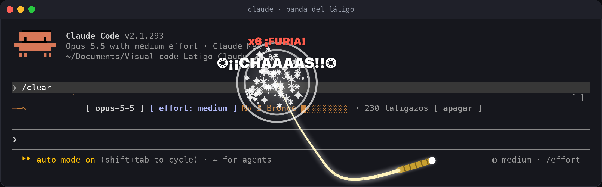
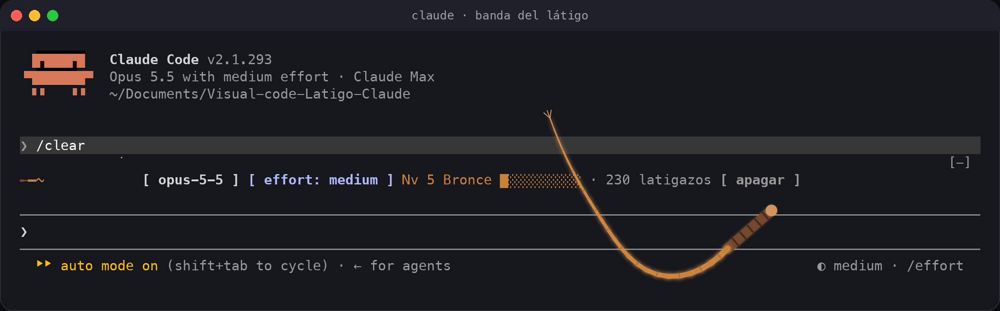
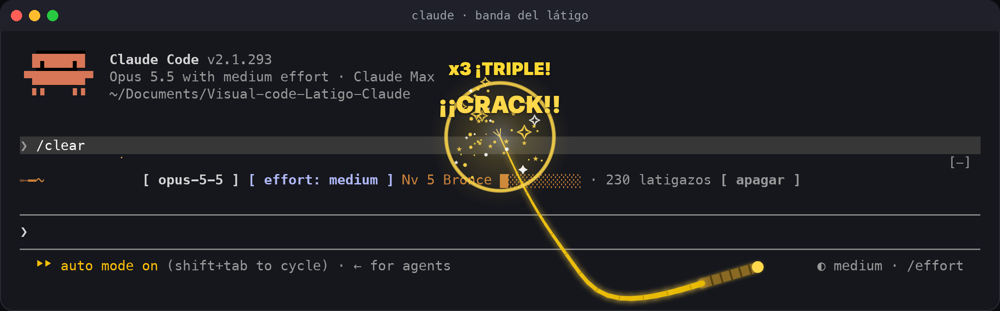
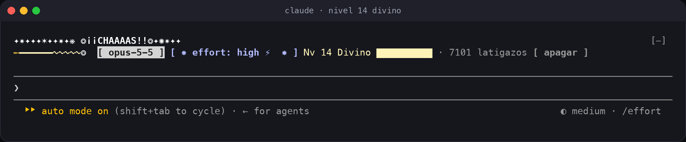
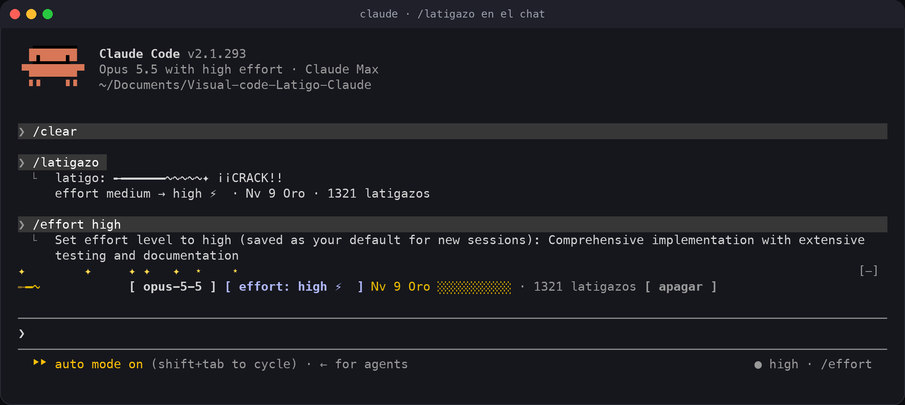
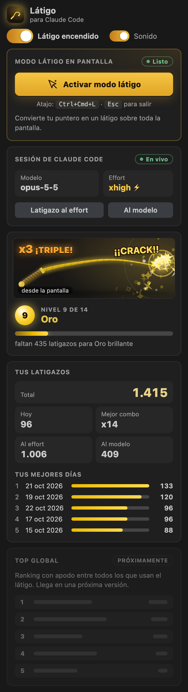
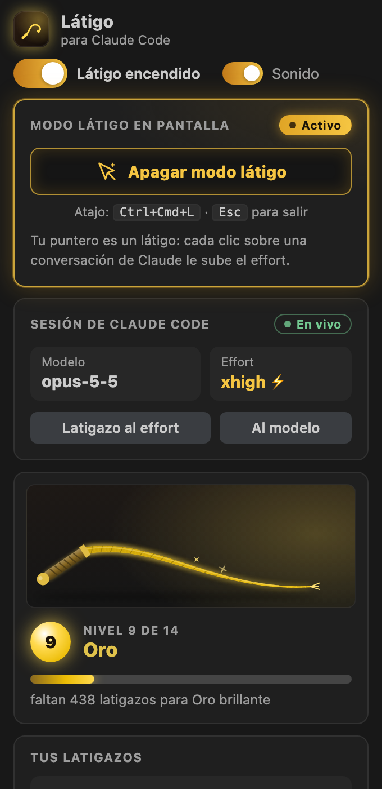
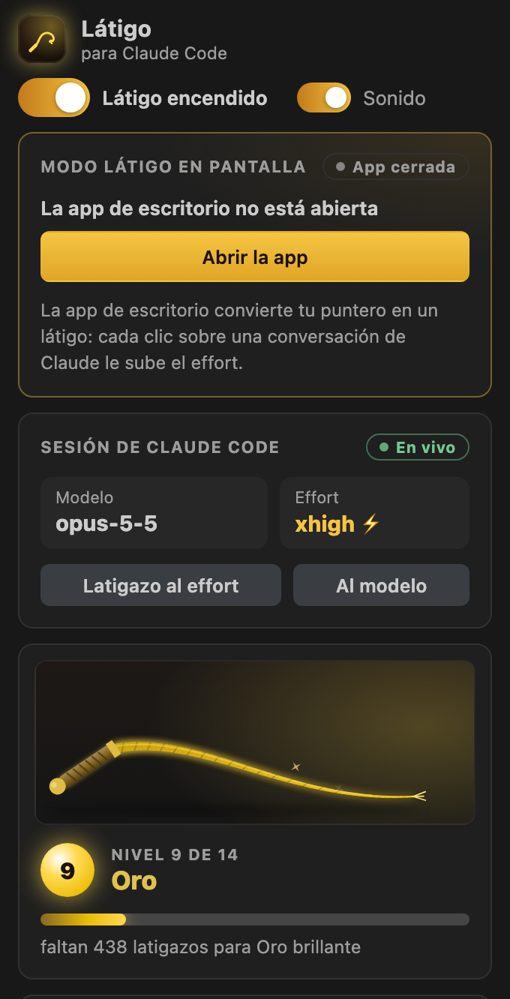
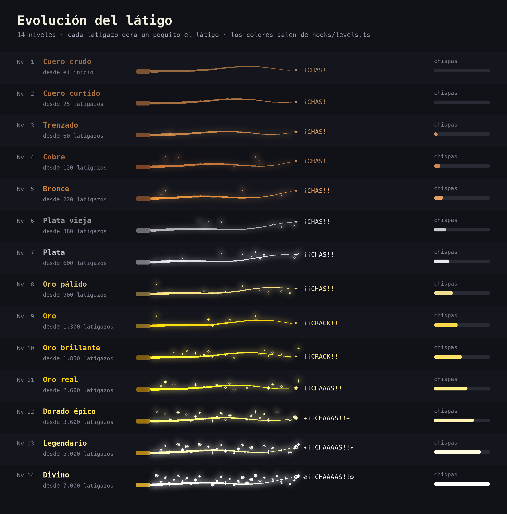

# Látigo para Claude Code

*¡Suashh… CHAS!* Un látigo para darle ánimo a Claude Code. Prendes el **modo látigo**, tu puntero se vuelve un látigo y cada clic restalla encima de la pantalla. Si el golpe cae sobre una conversación de Claude, el **effort sube un nivel**. Mientras más lo usas, más dorado, brillante y épico se pone, muy poco a poco.



Son tres piezas que se hablan entre sí (todo queda en tu máquina, sin red):

| Pieza | Qué hace | Dónde |
|---|---|---|
| **App de escritorio** (Mac) | El modo látigo: tu puntero es un látigo y cada clic restalla sobre la pantalla, encima de VS Code, la terminal o lo que tengas | Ícono en la barra de menú · `Ctrl+Cmd+L` |
| **Plugin de Claude Code** | Sube el effort de verdad (con `/effort`), cuenta los latigazos, y en la consola dibuja una banda encima del prompt | Consola y chat de Claude en VS Code |
| **Extensión de VS Code** | Tus estadísticas y controles en la barra de la izquierda: modo látigo, sesión, nivel, combos, mejores días | Barra de actividad de VS Code |

---

## Contenido

- [Cómo se usa](#cómo-se-usa)
- [App de escritorio](#app-de-escritorio)
- [El sonido: nunca suena igual](#el-sonido-nunca-suena-igual)
- [En la consola](#en-la-consola)
- [En VS Code](#en-vs-code)
- [Niveles: el látigo se va dorando](#niveles-el-látigo-se-va-dorando)
- [Instalación](#instalación)
- [Comandos y atajos](#comandos-y-atajos)
- [Cómo funciona el effort](#cómo-funciona-el-effort)
- [Privacidad](#privacidad)
- [Preguntas frecuentes](#preguntas-frecuentes)
- [Desarrollo](#desarrollo)

## Cómo se usa

1. Abre la app **Látigo** (queda como un látigo en la barra de menú, arriba a la derecha).
2. Presiona **`Ctrl+Cmd+L`**: el puntero se vuelve un látigo.
3. Haz clic sobre tu conversación de Claude (en VS Code, la terminal o la app de Claude): **¡CHAS!** El golpe se ve encima de la pantalla y el effort sube un nivel: `medium → high → xhigh → max`. Lo ves en el selector de modelo del chat ("Opus 5.5 **High**").
4. **`Esc`** (o `Ctrl+Cmd+L` otra vez) y vuelves al puntero normal.

Los clics siguen funcionando mientras tanto: el latigazo solo se dibuja encima. Un clic fuera de una conversación de Claude es puro desahogo: suena, revienta y cuenta para tu nivel, pero no toca el effort. Varios seguidos (menos de 1,5 s entre uno y otro) hacen combo: `x2 ¡DOBLE!`, `x3 ¡TRIPLE!`, `x5 ¡FURIA!`, `x7 ¡IMPARABLE!`, `x10 ¡LEYENDA!`, `x20 ¡¡DIOS DEL LÁTIGO!!`.

Para volver al effort de antes: `/latigo calma` en Claude Code, o apagar el látigo.

## App de escritorio

| En reposo: el látigo cuelga del puntero | Golpe con combo, nivel 9 |
|---|---|
|  |  |

- **La punta del látigo va en tu puntero** y el mango lo sigue de lejos. La cuerda tiene física de verdad: cuelga, se mece cuando mueves el mouse y, en el clic, una onda la recorre del mango a la punta.
- **El golpe** trae destello, onda de choque, chispas del color de tu nivel y el grito del nivel (de `¡CHAS!` a `❂¡¡CHAAAAS!!❂`).
- **Sube el effort solo sobre Claude:** VS Code (y Cursor, Windsurf, VSCodium), Terminal, iTerm2, Warp, Ghostty, kitty, Alacritty, WezTerm y la app de Claude. Necesita el plugin instalado y una sesión abierta.
- **Menú de la barra:** prender el modo látigo, el sonido, tu nivel, abrir al iniciar sesión y salir.
- **Pantallas:** dibuja en todas las pantallas conectadas y está pensada para verse también sobre apps a pantalla completa. Si tienes *Reducir movimiento* activo en macOS, salen menos chispas.

Las fotos de esta sección las dibuja la misma app (`--demo`) encima de una captura real de Claude Code.

## El sonido: nunca suena igual

Cada latigazo de la app se sintetiza en el momento, imitando cómo suena un látigo real:

- **El zumbido:** el aire que corta la cuerda mientras la punta acelera (el afinamiento la acelera 30 a 40 veces). Sube de tono y de volumen.
- **El chasquido:** la punta, o el bucle que viaja por la cuerda, pasa la barrera del sonido, cerca de Mach 2 durante ~1,2 ms, y suelta una onda de choque ([Krehl y Engemann](https://publica.fraunhofer.de/handle/publica/193228), [Scientific American](https://www.scientificamerican.com/article/true-cause-of-whips-crack)).
- **Lo demás:** a veces un segundo chasquido, la caída de la cuerda y el eco del lugar.

Lo que cambia en cada golpe:

- La velocidad con que movías el mouse: un tirón rápido da un zumbido más corto, agudo y fuerte.
- La duración de la onda de choque, que cambia el timbre.
- El doble chasquido y el eco.
- El combo, que lo hace más brillante, y los niveles altos, que le suman un destello dorado.

En la consola, el plugin alterna tres chasquidos generados con el mismo modelo (`scripts/sonidos.py`).

## En la consola

En `claude` aparece una banda encima del prompt: clic en el effort (lo sube) o en el modelo (desahogo), y el botón `apagar`. Con `ctrl+x tab` la enfocas y usas `e`, `m` y `o`. `/latigazo` hace lo mismo escribiéndolo.





## En VS Code

El chat de Claude Code en VS Code no dibuja interfaz de plugins, así que el golpe en pantalla lo pone la app de escritorio. La extensión trae, en la **barra de la izquierda**, todo lo demás:

- El botón grande **Activar modo látigo**, que se lo pide a la app (o te ofrece abrirla).
- La **sesión de Claude**: modelo y effort (con ⚡ cuando el látigo lo está subiendo), y dos latigazos pequeños, al effort y al modelo.
- El **látigo de tu nivel** en miniatura, que también restalla con los golpes que das desde la pantalla o la consola.
- **Nivel, progreso, tus números, tus mejores días** y el **Top global** (en gris: llega en una próxima versión).

| Barra lateral | Modo látigo activo | App cerrada |
|---|---|---|
|  |  |  |

Al entrar a una conversación de Claude, la barra se abre sola si el látigo está prendido (ajuste `latigo.showWithClaude`). En `/latigazo` el chat de VS Code funciona igual que la consola.

## Niveles: el látigo se va dorando

Son 14 niveles. Cada latigazo corre el color **un poquito** hacia el del nivel siguiente: no se nota de un golpe a otro, pero sí de una semana a otra. Las chispas aparecen en el nivel 3 y al final son una lluvia. Subir de nivel tiene sonido y aviso propios.



| Nv | Nombre | Desde | | Nv | Nombre | Desde |
|---:|---|---:|---|---:|---|---:|
| 1 | Cuero crudo | 0 | | 8 | Oro pálido | 900 |
| 2 | Cuero curtido | 25 | | 9 | Oro | 1.300 |
| 3 | Trenzado | 60 | | 10 | Oro brillante | 1.850 |
| 4 | Cobre | 120 | | 11 | Oro real | 2.600 |
| 5 | Bronce | 220 | | 12 | Dorado épico | 3.600 |
| 6 | Plata vieja | 380 | | 13 | Legendario | 5.000 |
| 7 | Plata | 600 | | 14 | Divino | 7.000 |

## Instalación

### 1. Plugin de Claude Code (necesario para subir el effort)

En una terminal:

```
claude plugin install latigo --marketplace ronalc90/Visual-code-Latigo-Claude
```

O dentro de `claude`: `/plugin install latigo --marketplace ronalc90/Visual-code-Latigo-Claude`. Si ya lo tenías: `claude plugin marketplace update visual-code-latigo-claude` y reinicia Claude Code.

### 2. App de escritorio (Mac, macOS 13 o más nuevo)

Descarga `Latigo-macOS.zip` de la [última versión](https://github.com/ronalc90/Visual-code-Latigo-Claude/releases/latest), descomprímelo y mueve **Látigo.app** a Aplicaciones. Como no está firmada por Apple, la primera vez ábrela con **clic derecho → Abrir → Abrir**. Funciona en Mac con Intel y con chip Apple.

Para que arranque sola: en su menú, **Abrir al iniciar sesión**.

### 3. Extensión de VS Code (estadísticas y controles)

Descarga `latigo-claude-0.4.0.vsix` de la [última versión](https://github.com/ronalc90/Visual-code-Latigo-Claude/releases/latest) e instálala:

```
code --install-extension latigo-claude-0.4.0.vsix
```

O en VS Code: **Extensiones** → menú **…** → **Instalar desde VSIX…**. Pronto estará en el Marketplace.

## Comandos y atajos

| Dónde | Qué | Cómo |
|---|---|---|
| Cualquier app (Mac) | Prender / apagar el modo látigo | `Ctrl+Cmd+L` · `Esc` para salir |
| Claude Code | Latigazo al effort | `/latigazo` |
| Claude Code | Tu tabla | `/latigo` |
| Claude Code | Prender / apagar el látigo | `/latigo on` · `/latigo off` |
| Claude Code | Volver al effort de antes | `/latigo calma` |
| Claude Code | Sonido | `/latigo sonido` |
| Banda de la consola (enfocada con `ctrl+x tab`) | Effort, modelo, apagar | `e`, `m`, `o` |
| VS Code | Prender / apagar el látigo | `Shift+Option+L` (Mac) · `Shift+Alt+L` (Windows y Linux) |
| VS Code | Modo látigo en pantalla | Botón de la barra lateral, o **Látigo: Prender/Apagar el modo látigo en pantalla** |

El resto de los comandos de VS Code está en la [página de la extensión](vscode/README.md#comandos).

## Cómo funciona el effort

El látigo cambia el effort con el mismo comando de Claude Code, `/effort`, así que lo ves en todas partes: en el selector de modelo del chat de VS Code, en el indicador de la consola (`● high · /effort`) y en la banda con ⚡.

- **Nunca baja.** Si ya vas en `max`, se queda en `max`.
- **`/latigo calma` y apagar el látigo devuelven el effort que tenías.** Si tú lo subiste a mano por encima, se respeta lo tuyo.
- **Claude Code guarda `/effort` como predeterminado** para sesiones nuevas (salvo `max`, que es solo de la sesión). Calmar el látigo devuelve también ese predeterminado.
- **Solo toca la conversación principal**, no los subagentes.

Detalles en [docs/arquitectura.md](docs/arquitectura.md).

## Privacidad

- **Nada usa la red:** ni la app, ni el plugin, ni la extensión.
- **Todo vive en `~/.claude-latigo/`:** unos archivos JSON pequeños.
- **La app no graba tu pantalla ni lee lo que escribes.** Del clic solo usa la posición y el nombre de la app que hay debajo, para saber si es una conversación de Claude.

## Preguntas frecuentes

**¿Interrumpe lo que Claude está haciendo?**
No. Nunca manda `Ctrl-C`; el effort nuevo aplica a los pedidos siguientes.

**¿Por qué el látigo no se dibuja adentro del chat de VS Code?**
Ese chat no muestra interfaz de plugins, y VS Code no deja que otra extensión dibuje encima. Por eso el golpe lo pone la app de escritorio, que dibuja sobre toda la pantalla.

**¿Y en Windows o Linux?**
El plugin y la extensión funcionan. La app de escritorio por ahora es solo para Mac.

**¿Qué pasa si borro `~/.claude-latigo/`?**
El plugin guarda los conteos también en su propio almacén y los vuelve a escribir en el próximo latigazo, así que todavía no hay forma de reiniciarlos.

**¿Y si tengo varias sesiones de Claude abiertas?**
Comparten el látigo: un latigazo al effort desde la pantalla o desde VS Code las sube a todas.

## Desarrollo

```
claude plugin validate ./ && claude plugin test ./            # plugin: 99 pruebas
npx tsc -p .                                                   # tipos del plugin
cd vscode && npm ci --include=dev && npm test                  # extensión: 147 unitarias + 26 en VS Code real
desktop/build.sh --test                                        # app de escritorio + 98 comprobaciones
python scripts/e2e_puente.py --claude "$(which claude)"        # 22 de punta a punta con Claude Code real
```

| Carpeta | Qué hay |
|---|---|
| `hooks/` | El plugin y las reglas compartidas (`model.ts`, `levels.ts`, `bridge.ts`) |
| `desktop/` | La app de escritorio en Swift: física, sintetizador, dibujo, puente |
| `vscode/` | La extensión de VS Code |
| `assets/` | Sonidos generados desde cero |
| `scripts/` | Capturas reales, prueba de punta a punta, sonidos y datos de niveles |
| `docs/` | [Arquitectura](docs/arquitectura.md), [pruebas](docs/pruebas.md), [cómo publicar](docs/publicar.md) e imágenes |

## Lo que viene

- **Top global:** un ranking opcional, con apodo, de quién da más latigazos.
- **App de escritorio para Windows.**

## Inspiración

[OpenWhip](https://github.com/GitFrog1111/OpenWhip) fue el primer látigo. Este nació para hacer lo mismo sin interrumpir el trabajo, y para que cada golpe sirva de algo.

## Licencia

[MIT](LICENSE) © Ronald Cipagauta
