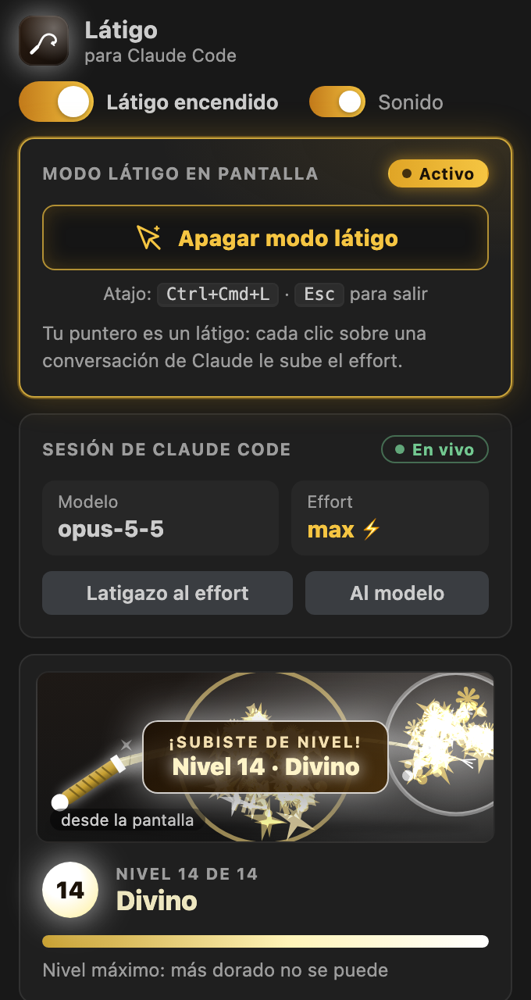
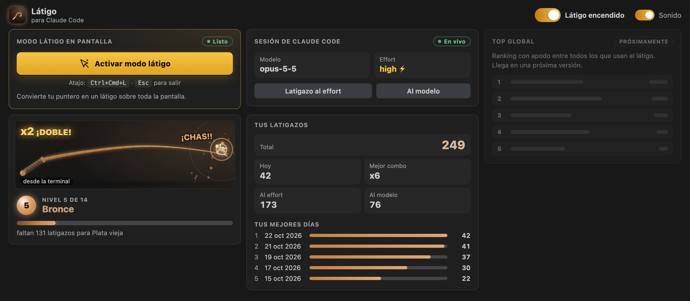
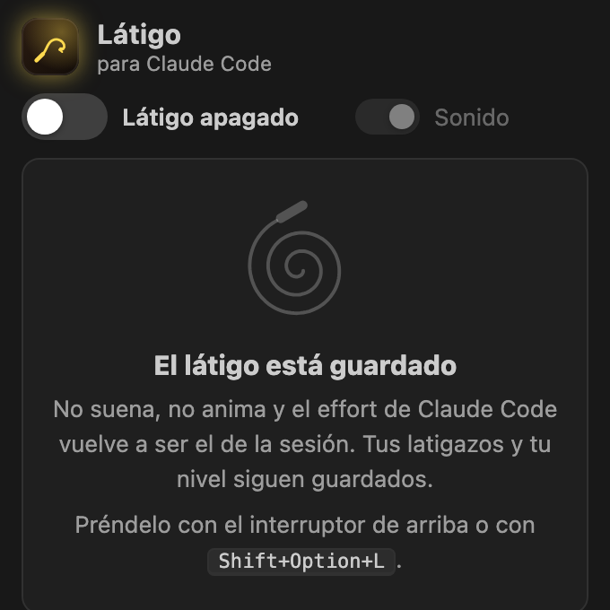

# Látigo para Claude Code

**Tus latigazos, tu nivel y el modo látigo en pantalla, a un clic desde la barra lateral de VS Code.** *¡Suashh… CHAS!*

Haz clic en el ícono del látigo en la **barra de la izquierda**. Ahí tienes el botón grande para **activar el modo látigo en pantalla** (con la app de escritorio, tu puntero se vuelve un látigo y cada clic sobre una conversación de Claude le sube el effort), la sesión de Claude Code con su modelo y su effort, tu nivel con el látigo en miniatura y todos tus números. El panel está pensado para la barra lateral angosta y también se acomoda en ancho completo.

| En la barra lateral | Con el modo látigo activo |
|---|---|
|  |  |

## Lo que trae

- **Modo látigo en pantalla.** Un botón grande: *Activar modo látigo* / *Apagar modo látigo*. Se lo pide a la app de escritorio, que convierte tu puntero en un látigo sobre toda la pantalla: cada clic lo restalla y, si cae sobre una conversación de Claude, le sube el effort. Atajo de la app: `Ctrl+Cmd+L`; `Esc` para salir. También desde la paleta: **Látigo: Prender/Apagar el modo látigo en pantalla**.
- **Si la app no está abierta,** el panel lo dice y trae el botón **Abrir la app**. Si no está instalada, te lleva a la guía de instalación. Por ahora la app es solo para Mac; en Windows y Linux el panel lo indica y lo demás funciona igual.
- **La sesión de Claude Code.** Modelo y effort de la sesión abierta; el ⚡ indica que el látigo lo está subiendo. Dos botones chicos: **Latigazo al effort** (lo sube un nivel: `low → medium → high → xhigh → max`) y **Al modelo** (solo para desahogarse).
- **Tu nivel, con el látigo en miniatura.** Una vista previa del látigo con el color de tu nivel, que se mece y echa chispas según lo alto que estés. Cada latigazo, venga de VS Code, de la terminal o del látigo en pantalla, se ve ahí: chasquido, chispas y el grito del combo (`x2 ¡DOBLE!`, `x3 ¡TRIPLE!` … `x20 ¡¡DIOS DEL LÁTIGO!!`). Barra de progreso y cuántos latigazos faltan para el siguiente nivel.
- **14 niveles.** De *Cuero crudo* a *Divino*: el color avanza un poquito con cada latigazo y las chispas se vuelven lluvia en los niveles altos. Al subir de nivel aparece un letrero.
- **Tus números.** Total, hoy, mejor combo, al effort, al modelo y tus 5 mejores días.
- **Interruptor grande e interruptor de sonido.** Apagado no suena, no anima y el effort vuelve a ser el de la sesión. Es el mismo interruptor de Claude Code: si lo apagas aquí, se apaga allá.
- **Se abre solo al entrar al chat de Claude Code** (si el látigo está prendido), sin quitarle el foco a la conversación. Se apaga con el ajuste `latigo.showWithClaude`.
- **Barra de estado.** `🔥 Látigo · Nv 5` abajo a la derecha; con el modo látigo activo cambia a `⚡ Modo látigo · Nv 5`. Un clic abre el panel.
- **Se lleva con el tema** y **respeta el movimiento reducido**: si tu sistema lo pide, el látigo no se mece y hay menos chispas.

| La app de escritorio cerrada | Nivel 14 · Divino, subiendo de nivel |
|---|---|
|  |  |

| En ancho completo | Apagado |
|---|---|
|  |  |

## Cómo se conecta con Claude Code

La extensión es la mitad de VS Code del plugin **latigo** de Claude Code. Las dos mitades hablan por unos pocos archivos JSON en `~/.claude-latigo/`: ninguna abre sockets ni toca la red.

1. Instala el plugin en Claude Code. Desde VS Code: **Látigo: Instalar el plugin en Claude Code** abre una terminal con el comando listo para que lo revises y presiones Enter:

   ```
   claude plugin install latigo --marketplace ronalc90/Visual-code-Latigo-Claude
   ```

   O dentro de `claude`: `/plugin install latigo --marketplace ronalc90/Visual-code-Latigo-Claude`.
2. Abre una sesión de Claude Code. El panel muestra el modelo y el effort de esa sesión.
3. Dale al effort. El latigazo llega a la sesión y el effort sube un nivel.

Si no hay una sesión abierta, el latigazo igual se ve, suena y cuenta, pero el panel te avisa que no llegó a ninguna sesión: no queda un pedido colgado para la próxima.

Los latigazos que das en la banda de Claude Code (en la terminal) y con el látigo en pantalla también se animan en la vista previa del panel, y los conteos y el nivel son los mismos en todos lados.

## App de escritorio (modo látigo en pantalla)

El modo látigo vive en una app de escritorio para Mac. La extensión no dibuja nada fuera de VS Code: solo la abre (`open -a "Látigo"`) y le pide prender o apagar el modo látigo escribiendo en `~/.claude-latigo/whipmode.json`. La app avisa que está abierta y si el modo está activo en `~/.claude-latigo/desktop.json`, y el panel lo muestra. Cómo instalarla: [App de escritorio](https://github.com/ronalc90/Visual-code-Latigo-Claude#app-de-escritorio).

## Atajos de teclado

| Acción | macOS | Windows | Linux |
|---|---|---|---|
| Encender / apagar el látigo | `Shift+Option+L` | `Shift+Alt+L` | `Shift+Alt+L` |
| Modo látigo en pantalla (atajo de la app de escritorio, en todo el sistema) | `Ctrl+Cmd+L`, y `Esc` para salir | — | — |

En Mac, `Ctrl+Cmd+L` es de la app de escritorio, para el modo látigo en cualquier app; por eso prender y apagar el látigo en VS Code va con `Shift+Option+L`.

En Windows y Linux no se usa `Ctrl+Alt+L`. En Windows, `Ctrl+Alt` es la tecla AltGr y taparía letras como la `ł` del teclado polaco; en Linux, `Ctrl+Alt+L` bloquea la pantalla en varios escritorios. Puedes cambiar el atajo en **Preferencias: Atajos de teclado** buscando `latigo.toggle`.

En la banda de Claude Code (terminal) el atajo de VS Code no aplica: allá se apaga con la tecla `o` con la banda enfocada, con el botón **apagar** o con `/latigo on` y `/latigo off`.

## Comandos

Todos están en la paleta (`Cmd+Shift+P` / `Ctrl+Shift+P`), en la categoría **Látigo**.

| Comando | Qué hace |
|---|---|
| Látigo: Abrir el panel | Abre el látigo en la barra lateral |
| Látigo: Prender/Apagar el modo látigo en pantalla | Le pide a la app de escritorio prender o apagar el puntero de látigo |
| Látigo: Encender/Apagar | Prende o apaga el látigo (aquí y en Claude Code) |
| Látigo: Latigazo al effort | Da un latigazo al effort sin abrir el panel |
| Látigo: Latigazo al modelo | Da un latigazo al modelo (solo visual) |
| Látigo: Prender/Apagar el sonido | Cambia el sonido de los latigazos |
| Látigo: Ver mis latigazos | Muestra tus números en una notificación |
| Látigo: Instalar el plugin en Claude Code | Abre una terminal con el comando de instalación |

## Ajustes

| Ajuste | Valor por defecto | Para qué |
|---|---|---|
| `latigo.showWithClaude` | `true` | Al entrar a una conversación de Claude Code, abre el látigo en la barra lateral (si está prendido), sin quitarle el foco al chat |
| `latigo.showStatusBar` | `true` | Muestra el nivel en la barra de estado |
| `latigo.reducedMotion` | `"auto"` | `auto` sigue al sistema; `on` siempre reduce el movimiento (el látigo no se mece); `off` siempre anima todo |
| `latigo.volume` | `0.7` | Volumen del latigazo y de la subida de nivel, de `0` a `1` |

El interruptor y el sonido no son ajustes de VS Code: viven en `~/.claude-latigo/config.json` porque los comparte con Claude Code.

## Privacidad

- **Sin red.** La extensión no hace ninguna conexión: ni telemetría, ni analítica, ni recursos remotos en el panel (CSP estricta). El único enlace, *Cómo instalarla*, lo abre tu navegador cuando le das clic.
- **Solo una carpeta.** Lee y escribe únicamente en `~/.claude-latigo/`: `config.json`, `stats.json`, `effort.json`, `lash.json`, `presence.json`, `desktop.json` y `whipmode.json`.
- **Un solo programa externo.** En Mac, el botón *Abrir la app* corre `open -a "Látigo"`. Nada más.
- **Sin datos de tu código.** No lee tus archivos, tus conversaciones ni tus prompts.

## Preguntas frecuentes

**¿Interrumpe lo que Claude Code está haciendo?**
No. El latigazo al effort solo cambia el effort de los turnos siguientes de la conversación principal. No manda `Ctrl-C` ni corta nada.

**¿El effort baja alguna vez?**
El látigo nunca lo baja. Si la sesión ya va más alto, se queda como está. Con `/latigo calma` en Claude Code vuelve a ser el de la sesión.

**¿Por qué el effort dice «sin sesión»?**
Porque no hay una sesión de Claude Code abierta con el plugin instalado. Cuando cierras Claude Code, el panel se entera enseguida. Si Claude Code se cerró de golpe, tarda hasta 15 segundos.

**¿Y si tengo varias sesiones de Claude Code abiertas?**
Todas comparten el látigo: un latigazo al effort desde VS Code las sube a todas, y el panel muestra el modelo y el effort de la que habló último.

**No suena.**
Revisa el interruptor **Sonido** del panel y el ajuste `latigo.volume`. El sonido de los latigazos de VS Code sale del panel, así que suena cuando el panel está abierto; los de la terminal y los del látigo en pantalla suenan allá.

**¿Puedo reiniciar mis números?**
Todavía no. Los conteos solo crecen, y el plugin de Claude Code guarda su propia copia: si borras `~/.claude-latigo/stats.json`, la vuelve a escribir. Reiniciarlos está en la lista para una próxima versión.

**¿Por qué el látigo no se dibuja adentro del chat de Claude?**
Porque VS Code no deja que una extensión dibuje o escuche clics dentro de la ventana de otra. Para eso está el modo látigo en pantalla de la app de escritorio, que va por encima de todo. Adentro del chat también está `/latigazo`.

**Le doy a «Activar modo látigo» y no pasa nada.**
El botón espera a que la app confirme. Si a los pocos segundos sigue igual, revisa que la app de escritorio esté abierta y actualizada. La app se da por cerrada si no avisa durante 6 segundos.

**¿Y el Top global?**
Viene en una próxima versión: un ranking opcional, con apodo, entre todos los que usan el látigo. Por ahora la sección se ve pero está deshabilitada.

## Licencia

[MIT](LICENSE) © 2026 Ronald Cipagauta
